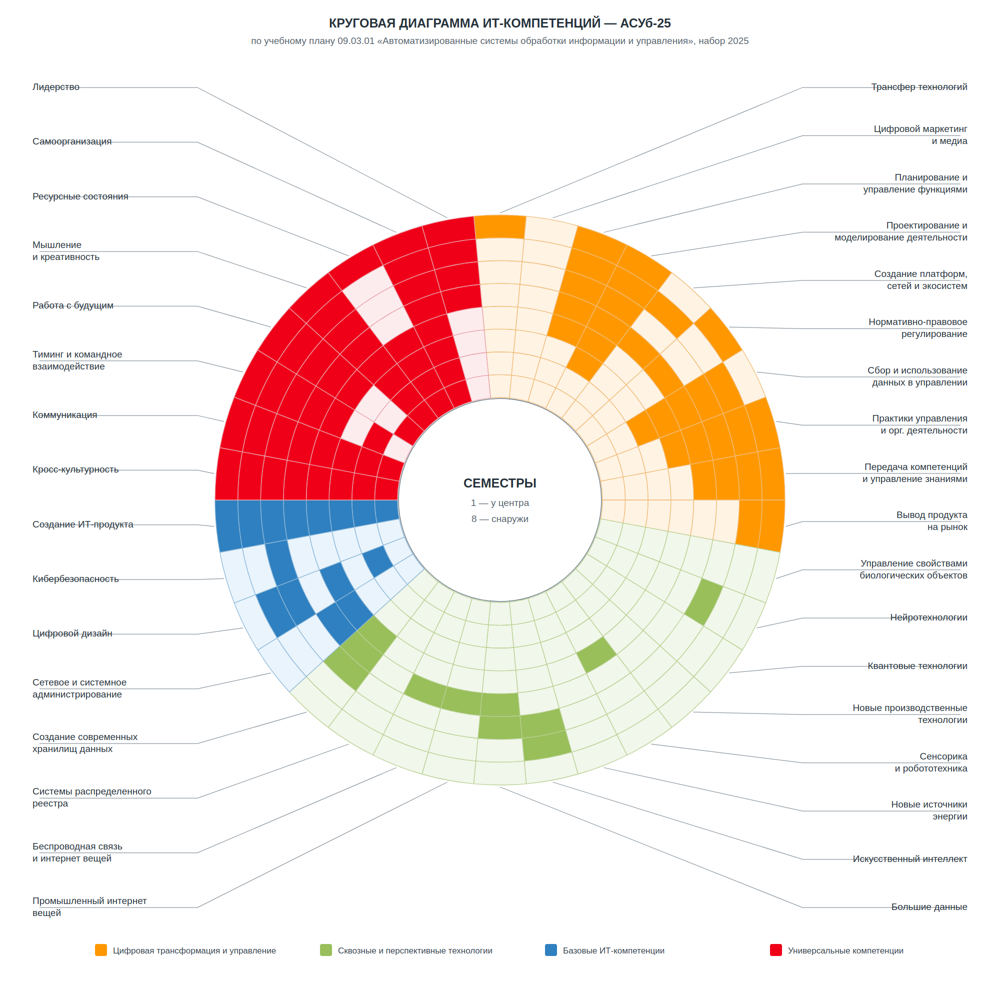

# Анализ ИТ-компетенций по учебному плану АСУб-25

## Исходные данные

- направление: 09.03.01 «Информатика и вычислительная техника»;
- профиль: «Автоматизированные системы обработки информации и управления»;
- форма обучения: очная;
- год начала подготовки: 2025;
- продолжительность: 8 семестров;
- источник: [официальный учебный план ИРНИТУ](https://app.istu.edu/oop/uploads/files/%D0%90%D0%A1%D0%A3%D0%B1-25/%D0%A3%D1%87%D0%B5%D0%B1%D0%BD%D1%8B%D0%B9_%D0%BF%D0%BB%D0%B0%D0%BD_%D0%90%D0%A1%D0%A3%D0%B1-25.pdf).

В круговой диаграмме внутреннее кольцо соответствует первому семестру, внешнее — восьмому. Насыщенная ячейка означает, что в данном семестре есть дисциплина или практика, непосредственно либо существенно формирующая указанную компетенцию. Светлая ячейка означает, что явного подтверждения в учебном плане нет.

Это аналитическая интерпретация учебного плана для семестрового задания, а не официальная матрица компетенций университета.

## Заполненная диаграмма



Также доступна [векторная версия](it-competencies-asub-25.svg), которая не теряет качество при печати и увеличении.

## Обоснование заполнения

| Блок | Компетенция | Семестры | Основные дисциплины и виды работы |
|---|---|---:|---|
| Цифровая трансформация | Трансфер технологий | 8 | основы коммерциализации технологий / технологическое предпринимательство |
| Цифровая трансформация | Цифровой маркетинг и медиа | — | отдельной дисциплины в плане нет |
| Цифровая трансформация | Планирование и управление функциями | 4–8 | основы проектной деятельности, проектная деятельность, управление разработкой ПО, экономическое обоснование ИТ-проектов |
| Цифровая трансформация | Проектирование и моделирование деятельности | 3–8 | исследование операций, теория автоматического управления, моделирование систем, проектирование АСОИУ |
| Цифровая трансформация | Создание платформ, сетей и экосистем | 5, 7 | сети и телекоммуникации, интернет-технологии, технологии разработки программных комплексов, 1С:Предприятие |
| Цифровая трансформация | Нормативно-правовое регулирование | 5, 8 | правоведение, защита интеллектуальной собственности / авторское право |
| Цифровая трансформация | Сбор и использование данных в управлении | 3–7 | теория вероятностей и статистика, базы данных, методы анализа данных, Big Data, системы ИИ |
| Цифровая трансформация | Практики управления и организационной деятельности | 4–8 | основы проектной деятельности, проектная деятельность, управление разработкой ПО, практики |
| Цифровая трансформация | Передача компетенций и управление знаниями | 5–8 | проектная деятельность, командная защита проектов, производственные практики |
| Цифровая трансформация | Вывод продукта на рынок | 7–8 | экономическое обоснование ИТ-проектов, коммерциализация технологий / технологическое предпринимательство |
| Сквозные технологии | Управление свойствами биологических объектов | — | профильных дисциплин нет |
| Сквозные технологии | Нейротехнологии | 6 | нейронные сети и их приложения |
| Сквозные технологии | Квантовые технологии | — | профильных дисциплин нет |
| Сквозные технологии | Новые производственные технологии | — | отдельной профильной дисциплины нет |
| Сквозные технологии | Сенсорика и робототехника | 4 | основы цифровой электроники, теория автоматического управления; покрытие косвенное |
| Сквозные технологии | Новые источники энергии | — | профильных дисциплин нет |
| Сквозные технологии | Искусственный интеллект | 6–7 | нейронные сети и их приложения, системы искусственного интеллекта |
| Сквозные технологии | Большие данные | 5–6 | методы анализа данных, основы технологий Big Data |
| Сквозные технологии | Промышленный интернет вещей | 5 | сети и телекоммуникации, интернет-технологии; покрытие косвенное |
| Сквозные технологии | Беспроводная связь и интернет вещей | 5 | сети и телекоммуникации, интернет-технологии; покрытие косвенное |
| Сквозные технологии | Системы распределённого реестра | — | профильных дисциплин нет |
| Сквозные технологии | Создание современных хранилищ данных | 4–6 | базы данных, методы анализа данных, Big Data |
| Базовые ИТ | Сетевое и системное администрирование | 4–5 | операционные системы, сети и телекоммуникации, интернет-технологии |
| Базовые ИТ | Цифровой дизайн | 2, 4, 6–7 | инженерная графика, компьютерная графика, проектирование АСОИУ |
| Базовые ИТ | Кибербезопасность | 6 | защита информации |
| Базовые ИТ | Создание ИТ-продукта | 1–8 | программирование, ООП, методы программирования, Web, скриптовые языки, программные комплексы, проект и ВКР |
| Универсальные | Кросс-культурность | 1–8 | иностранный язык |
| Универсальные | Коммуникация | 1–8 | деловая коммуникация, иностранный язык, проектные защиты и практики |
| Универсальные | Тиминг и командное взаимодействие | 2, 4–8 | учебная практика, проектная деятельность, производственные практики |
| Универсальные | Работа с будущим | 1, 4–8 | введение в профессиональную деятельность, проектная деятельность, практики и ВКР |
| Универсальные | Мышление и креативность | 1–8 | математика, программирование, критическое и системное мышление, моделирование, проектирование |
| Универсальные | Ресурсные состояния | 1–4, 8 | физическая культура, безопасность жизнедеятельности |
| Универсальные | Самоорганизация | 1–8 | самостоятельная работа, лабораторные, проекты и практики |
| Универсальные | Лидерство | 5–8 | проектная деятельность, управление разработкой ПО, практики |

## Вывод

Учебный план сильнее всего развивает создание ИТ-продукта, программирование, проектирование информационных систем, работу с данными и универсальные командные навыки. На старших курсах появляются нейронные сети, искусственный интеллект и Big Data. Наименее представлены квантовые технологии, распределённые реестры, биообъекты, новые источники энергии и цифровой маркетинг — эти сектора оставлены незаполненными намеренно.

Диаграмма строится командой:

```bash
node docs/it-competencies/generate-wheel.mjs
```

